# Awesome-Financial-Analysis-Trading-Strategy-Prompts 🚀

<p align="center">
  
</p>

<p align="center">
  <a href="https://github.com/ishandutta2007/Awesome-Awesome-Awesome"></a><a href="https://discord.gg/jc4xtF58Ve"></a>
  <a href="https://github.com/ishandutta2007/Awesome-Financial-Analysis-Trading-Strategy-Prompts/stargazers"></a>
  <a href="https://github.com/ishandutta2007/Awesome-Financial-Analysis-Trading-Strategy-Prompts/network/members"></a>
  <a href="LICENSE"></a>
  <a href="https://github.com/ishandutta2007"></a>
</p>

# 📈 Top Financial Analysis & Trading Strategy Prompts 🤖

> **A curated directory of top-tier SaaS platforms, AI prompt engineering frameworks, LLM financial analyst tools, and high-performance open-source algorithmic trading engines.**

*Comprehensive guide for quantitative developers 💻, algorithmic traders 📊, financial analysts 📑, and fintech engineers building automated trading pipelines, systematic factor investing strategies, AI-driven stock screeners, and backtesting systems.*

**Last updated: November 2026** 📅

---

## 📑 Table of Contents
- [🎯 Executive Summary & Highlights](#-executive-summary--highlights)
- [📊 Sector Overview & Market Dynamics](#-sector-overview--market-dynamics)
- [☁️ SaaS/Hosted & Commercial Platforms](#️-saashosted--commercial-platforms)
- [💻 Open-Source GitHub Projects](#-open-source-github-projects)
- [💡 Common AI Prompts for Financial Analysis](#-common-ai-prompts-for-financial-analysis)
- [🛠️ How to Contribute](#️-how-to-contribute)
- [⚠️ Disclaimer](#️-disclaimer)
- [⭐ Star History](#-star-history)
- [💖 Support & Thank You](#-support--thank-you)

---

## 🎯 Executive Summary & Highlights

This repository tracks notable **SaaS/Commercial platforms** ☁️ and **open-source projects** 💻 powering the modern quantitative finance and AI trading stack:
- **🤖 LLM Prompt Engineering & Autonomous Financial Agents**: Multi-agent consensus architectures (`TradingAgents`, `ai-hedge-fund`, `claude-trading-skills`, `FinGPT`) synthesizing fundamental, technical, and macro indicators into actionable trading theses.
- **⚡ Event-Driven & Vectorized Backtesting Engines**: High-performance execution environments (`LEAN`, `NautilusTrader`, `Backtrader`, `VectorBT`, `Freqtrade`, `Jesse`) capable of simulating tick-level order books and multi-asset rebalancing.
- **🌐 Open Investment Terminals & Data Feeds**: Modern, open data platforms (`OpenBB`, `yfinance`, `Alpaca`) liberating institutional-grade market data, SEC filings, and options analytics.

---

## 📊 Sector Overview & Market Dynamics

The global Algorithmic Trading, Quantitative Analytics & AI Financial Research Software market is valued at approximately **$24B–$30B+ in 2026**, expanding at a ~13%–17% CAGR toward $50B+ by 2032—accelerated by LLM-driven strategy synthesis, multi-agent fundamental/technical analysis, and API-first retail/institutional execution. The brokerage and charting layer exhibits **strong winner-take-most consolidation** around Interactive Brokers, TradingView, and NinjaTrader, while the backtesting, quant terminal, and AI-agent strategy layer is **heavily driven by open-source ecosystems** (`OpenBB`, `LEAN`, `NautilusTrader`, `Freqtrade`, `Backtrader`, `FinGPT`).

---

## ☁️ SaaS/Hosted & Commercial Platforms

*Sorted descending by company valuation / annual revenue scale.* 🏆

| Platform | Description | Company Scale (Valuation / Revenue) | Starting Paid Tier | Free Tier / Trial Limit |
| :--- | :--- | :--- | :--- | :--- |
| **[Interactive Brokers (IBKR)](https://interactivebrokers.com)** | Institutional-grade global brokerage and algorithmic execution platform offering TWS API, Python/C++ SDKs, and PortfolioAnalyst across 150+ markets. | **~$5.2B+ Annual Revenue** (~$75B+ public market cap on NASDAQ) | **$0 / month software fee** (IBKR Pro tiered commissions from **$0.0005–$0.0035/share**; $0 IBKR Lite US equities) | **Forever Free Paper Trading & API** (Unlimited free paper-trading account, TWS workstation, and full API access with funded/trial login) |
| **[TradingView](https://tradingview.com)** | Cloud charting, social strategy marketplace, and Pine Script algorithmic backtesting/webhook alert platform used by 90M+ traders worldwide. | **~$3.0B+ Valuation** (~$300M+ est. ARR) | **$12.95 / month** billed annually ($14.95/mo monthly for Essential plan) | **Forever Free Basic Plan** (1 chart per tab, **2 indicators per chart**, 1 active price alert, and basic Pine Script editor; 30-day paid trial) |
| **[NinjaTrader (Kraken)](https://ninjatrader.com)** | Futures brokerage and Windows algorithmic trading platform supporting C# NinjaScript strategy development, tick-level backtesting, and automated execution. | **Acquired by Kraken for $1.5B** (~$150M+ est. annual revenue) | **$99 / month** Lease (or **$1,499 one-time** Lifetime license for lower commissions + Order Flow+) | **Forever Free Platform & Sim Trading** (100% free charting, C# NinjaScript coding, and simulated backtesting; live trading requires funded account) |
| **[TradeStation (Monex Group)](https://tradestation.com)** | Active-trader brokerage and EasyLanguage algorithmic strategy development, backtesting, and automated execution platform for equities, options, and futures. | **Part of Monex Group** (~$650M+ Monex Group revenue; ~$1B+ public market cap) | **$0 / month platform fee** for active equities/options traders ($99.95/mo for non-brokerage data/software) | **Forever Free Brokerage Account & Sim** ($0 commission US stocks/ETFs + free EasyLanguage strategy simulator with funded account) |
| **[Alpaca](https://alpaca.markets)** | Developer-first API brokerage for algorithmic stock, options, and crypto trading with Python/TypeScript SDKs and real-time market data streams. | **~$300M–$500M Est. Valuation** ($120M+ VC funding; powers 200+ fintech apps) | **$99 / month** for Algo Trader Plus (unlimited real-time SIP market data & higher API rate limits) | **Forever Free Paper & Live Trading API** ($0 commission US equities/options API + unlimited free paper trading and IEX real-time data) |
| **[MetaTrader 4 / 5 (MetaQuotes)](https://metatrader5.com)** | Ubiquitous multi-asset algorithmic trading terminal supporting MQL4/MQL5 Expert Advisors (EAs), strategy tester optimization, and VPS hosting. | **~$200M–$400M Est. Scale** (Profitable B2B broker-software giant) | **$0 / Free Terminal** (Built-in MetaTrader VPS starts at **~$15 / month**) | **100% Free Forever** (Unlimited MQL5 Expert Advisor coding, multi-threaded strategy backtesting, and broker demo accounts) |
| **[TrendSpider](https://trendspider.com)** | AI-powered technical analysis, automated multi-timeframe pattern recognition, Strategy Tester, and Trading Bots platform. | **~$30M–$50M Est. Valuation** (~$10M–$15M est. ARR; bootstrapped/profitable) | **$54 / month** billed annually ($107/mo monthly for Standard plan) | **14-Day Full-Access Free Trial** (Includes AI Strategy Lab, automated trendline detection, and multi-factor backtesting; no perpetual free tier) |
| **[Composer](https://composer.trade)** | AI-assisted visual and prompt-based ("Create with AI") systematic trading platform for building, backtesting, and auto-executing ETF/stock "symphonies." | **~$30M–$50M Est. Valuation** ($11M+ VC funding; backed by First Round/Left Lane) | **$24 / month** billed annually ($32/mo monthly for Trading Pass) | **Forever Free Research & Backtest Tier** (Unlimited AI symphony creation and historical backtesting; automated live execution requires Trading Pass) |
| **[QuantConnect](https://quantconnect.com)** | Cloud algorithmic trading IDE, institutional-grade multi-asset historical data library, and Mia AI strategy assistant built atop the open-source LEAN engine. | **~$20M–$40M Est. Valuation** (~$5M–$10M est. ARR; 300k+ quant community) | **$8 / month** billed annually (Quant Researcher) or **$20 / month** Team + live node fees | **Forever Free Community Plan** (Free cloud backtesting on 1 CPU node with 512 MB RAM and free US equity/crypto daily/minute data) |
| **[Portfolio123](https://portfolio123.com)** | Quantitative factor-investing, multi-factor stock screening, AI Factor ML modeling, and point-in-time fundamental backtesting SaaS. | **~$10M–$20M Est. Scale** (Bootstrapped quantitative research vendor) | **$25 / month** billed annually (Screener) or **$100 / month** Pro backtesting | **14-Day Free Trial** (Full access to point-in-time fundamental data, ranking systems, and strategy backtests during evaluation) |

---

## 💻 Open-Source GitHub Projects

*Sorted descending by GitHub_Stars_Count. Click on any Stars_Badge to view stargazers.* ✨

| Project | License / Hosting Cost | Free Tier / Self-Hosted Limit | Description |
| :--- | :--- | :--- | :--- |
| **[TradingAgents](https://github.com/TauricResearch/TradingAgents)** [](https://github.com/TauricResearch/TradingAgents/stargazers) | `Apache-2.0` / 100% Free Self-Hosted | **Unlimited 100% Free** (Open Source) | Towards Agentic Finance Research — multi-agent LLM trading prompts, financial debate, and quantitative decision pipelines. |
| **[OpenBB](https://github.com/OpenBB-finance/OpenBB)** [](https://github.com/OpenBB-finance/OpenBB/stargazers) | `AGPL-3.0` / 100% Free Self-Hosted | **Unlimited 100% Free** (Open Source) | Open Data Platform for investment analysts, quant researchers, and autonomous financial AI agents. |
| **[ai-hedge-fund](https://github.com/virattt/ai-hedge-fund)** [](https://github.com/virattt/ai-hedge-fund/stargazers) | `MIT` / 100% Free Self-Hosted | **Unlimited 100% Free** (Open Source) | An AI Hedge Fund Team of autonomous agents collaborating on fundamental, technical, sentiment, and risk analysis. |
| **[freqtrade](https://github.com/freqtrade/freqtrade)** [](https://github.com/freqtrade/freqtrade/stargazers) | `GPL-3.0` / 100% Free Self-Hosted | **Unlimited 100% Free** (Open Source) | Free, open source crypto algorithmic trading bot and backtesting engine written in Python supporting multi-exchange execution. |
| **[qlib](https://github.com/microsoft/qlib)** [](https://github.com/microsoft/qlib/stargazers) | `MIT` / 100% Free Self-Hosted | **Unlimited 100% Free** (Open Source) | AI-oriented quant investment platform empowering research across machine learning modeling, RL, and automated alpha factor mining. |
| **[ccxt](https://github.com/ccxt/ccxt)** [](https://github.com/ccxt/ccxt/stargazers) | `MIT` / 100% Free Self-Hosted | **Unlimited 100% Free** (Open Source) | Unified modular trading API connecting 100+ cryptocurrency exchanges and prediction markets with algorithmic execution. |
| **[nautilus_trader](https://github.com/nautechsystems/nautilus_trader)** [](https://github.com/nautechsystems/nautilus_trader/stargazers) | `LGPL-3.0` / 100% Free Self-Hosted | **Unlimited 100% Free** (Open Source) | Production-grade, highly modular Rust-native algorithmic trading engine with deterministic event-driven backtesting. |
| **[yfinance](https://github.com/ranaroussi/yfinance)** [](https://github.com/ranaroussi/yfinance/stargazers) | `Apache-2.0` / 100% Free Self-Hosted | **Unlimited 100% Free** (Open Source) | Download real-time and historical market data, options chains, and fundamental data from Yahoo! Finance via Python. |
| **[backtrader](https://github.com/mementum/backtrader)** [](https://github.com/mementum/backtrader/stargazers) | `GPL-3.0` / 100% Free Self-Hosted | **Unlimited 100% Free** (Open Source) | Feature-rich event-driven Python framework for backtesting and live trading strategies with built-in plotting and indicators. |
| **[Lean](https://github.com/QuantConnect/Lean)** [](https://github.com/QuantConnect/Lean/stargazers) | `Apache-2.0` / 100% Free Self-Hosted | **Unlimited 100% Free** (Open Source) | LEAN algorithmic trading engine by QuantConnect supporting multi-asset backtesting and live broker execution in C# and Python. |
| **[FinGPT](https://github.com/AI4Finance-Foundation/FinGPT)** [](https://github.com/AI4Finance-Foundation/FinGPT/stargazers) | `MIT` / 100% Free Self-Hosted | **Unlimited 100% Free** (Open Source) | Open-source financial large language models (LLMs) and fine-tuning pipelines for Robo-advising, sentiment, and strategy generation. |
| **[claude-quickstarts](https://github.com/anthropics/claude-quickstarts)** [](https://github.com/anthropics/claude-quickstarts/stargazers) | `MIT` / 100% Free Self-Hosted | **Unlimited 100% Free** (Open Source) | Deployable reference architectures and starter prompts for Claude agent workflows including financial analyst and research patterns. |
| **[FinRL](https://github.com/AI4Finance-Foundation/FinRL)** [](https://github.com/AI4Finance-Foundation/FinRL/stargazers) | `MIT` / 100% Free Self-Hosted | **Unlimited 100% Free** (Open Source) | Financial reinforcement learning framework for automated trading, portfolio allocation, and dynamic strategy optimization. |
| **[ta-lib-python](https://github.com/TA-Lib/ta-lib-python)** [](https://github.com/TA-Lib/ta-lib-python/stargazers) | `BSD-2-Clause` / 100% Free Self-Hosted | **Unlimited 100% Free** (Open Source) | Python C-wrapper for TA-Lib providing 150+ technical analysis indicators (momentum, volume, volatility, cycle). |
| **[vectorbt](https://github.com/polakowo/vectorbt)** [](https://github.com/polakowo/vectorbt/stargazers) | `Apache-2.0` / 100% Free Self-Hosted | **Unlimited 100% Free** (Open Source) | Ultra-fast vectorized backtesting and quantitative analysis engine built on NumPy and Numba for lightning-fast strategy parameter sweeps. |
| **[jesse](https://github.com/jesse-ai/jesse)** [](https://github.com/jesse-ai/jesse/stargazers) | `MIT` / 100% Free Self-Hosted | **Unlimited 100% Free** (Open Source) | Advanced algorithmic trading bot and backtesting framework written in Python designed for simplicity and accuracy. |
| **[claude-trading-skills](https://github.com/tradermonty/claude-trading-skills)** [](https://github.com/tradermonty/claude-trading-skills/stargazers) | `MIT` / 100% Free Self-Hosted | **Unlimited 100% Free** (Open Source) | Claude Code skills for equity investors and quant traders — technical charting, economic calendars, and trading strategy prompt engineering. |
| **[ta](https://github.com/bukosabino/ta)** [](https://github.com/bukosabino/ta/stargazers) | `MIT` / 100% Free Self-Hosted | **Unlimited 100% Free** (Open Source) | Technical Analysis Library using Pandas and NumPy with 40+ indicators across trend, momentum, volatility, and volume. |
| **[mplfinance](https://github.com/matplotlib/mplfinance)** [](https://github.com/matplotlib/mplfinance/stargazers) | `BSD-3-Clause` / 100% Free Self-Hosted | **Unlimited 100% Free** (Open Source) | Financial markets data visualization, OHLC candlestick charting, and technical indicator plotting for Python. |
| **[finmarketpy](https://github.com/cuemacro/finmarketpy)** [](https://github.com/cuemacro/finmarketpy/stargazers) | `Apache-2.0` / 100% Free Self-Hosted | **Unlimited 100% Free** (Open Source) | Python quantitative finance library for event-driven backtesting trading strategies and financial market analysis. |
| **[alpaca-py](https://github.com/alpacahq/alpaca-py)** [](https://github.com/alpacahq/alpaca-py/stargazers) | `Apache-2.0` / 100% Free Self-Hosted | **Unlimited 100% Free** (Open Source) | Official modern Python SDK for the Alpaca API supporting commission-free equities, options, crypto, and real-time streaming. |

---

## 💡 Common AI Prompts for Financial Analysis

Here are battle-tested prompt templates for quant research 🔬, financial statement analysis 📑, and algorithmic strategy generation ⚡:

### 1. Fundamental 10-K / 10-Q Financial Ratio Analysis Prompt 📊
```text
Act as a Chartered Financial Analyst (CFA) and Senior Equity Research Associate. 
Analyze the following quarterly earnings report and balance sheet data for [TICKER]:
1. Calculate and interpret key profitability ratios: Gross Margin, Operating Margin, ROIC, and Free Cash Flow Yield.
2. Evaluate debt sustainability and liquidity: Net Debt-to-EBITDA, Interest Coverage Ratio, and Current Ratio.
3. Identify top 3 operating risks mentioned in the MD&A (Management's Discussion & Analysis) section.
4. Synthesize bull vs. bear scenarios with a 12-month fair value estimate using a 2-stage Discounted Cash Flow (DCF) model.
```

### 2. Systematic Mean-Reversion Strategy Prompt (Python / VectorBT) 🐍
```text
Act as a Quantitative Strategist specializing in statistical arbitrage and mean-reversion.
Generate an institutional-grade, vectorized Python strategy using vectorbt with the following specs:
- Asset universe: S&P 500 constituents (daily OHLCV).
- Indicator: 20-day Bollinger Bands with 2 standard deviations and 14-day RSI.
- Entry: Enter long when close drops below lower band AND RSI < 30.
- Exit: Close long position when price touches the 20-day SMA or 8% trailing stop-loss.
- Include slippage (5 bps) and commissions ($0.005/share).
- Output full Python code calculating Sharpe ratio, Max Drawdown, Calmar ratio, and monthly returns heatmap.
```

### 3. Pine Script v5 Multi-Timeframe Trend-Following Prompt 🌲
```text
Act as an expert Pine Script v5 developer.
Create a TradingView indicator and strategy script with:
1. Multi-timeframe EMA trend filter (50 EMA on 1D timeframe applied to 1H execution chart).
2. Dynamic ATR-based trailing stop with configurable multiplier (default: 2.5x ATR).
3. Visual webhook alerts formatted for automated execution via Alpaca and Interactive Brokers.
4. Clean table HUD displaying win rate, profit factor, current position, and unrealized P&L in the chart corner.
```

---

## 🛠️ How to Contribute

Contributions are highly welcome! 🙌 Help keep this curated list accurate and up-to-date:
1. **Fork** this repository 🍴.
2. **Create a branch** for your addition or correction (`git checkout -b add-my-tool`) 🌿.
3. Add the SaaS platform or open-source repo ensuring:
   - For SaaS: include specific starting pricing, free tier/trial limits, and revenue/valuation scale 💰.
   - For Open-Source: include license, short description, and correct GitHub stargazers badge 🏷️.
4. **Submit a Pull Request** with a brief summary of the project 🚀.

---

## ⚠️ Disclaimer

*This repository is curated for informational, educational, and research purposes only. Nothing contained herein constitutes financial, investment, legal, or tax advice. Past backtested performance is no guarantee of future returns. Always perform rigorous due diligence, paper-test algorithms thoroughly, and consult a licensed financial professional before risking capital.*

---

##  Star History
[](https://www.star-history.com/#ishandutta2007/Awesome-Financial-Analysis-Trading-Strategy-Prompts&type=date&legend=top-left)

---

## 💖 Support & Thank You

Thank you so much for visiting and using this curated resource! 🙏 If you find this repository valuable:
- ⭐ **Star this repository** to show your support and make it easier for other quant researchers to find.
- 🍴 **Fork it** to customize your personal quant trading prompts and stack.
- 🔄 **Share** with your quantitative finance, trading, and engineering networks.
- 🐛 **Open an issue or PR** if you discover outdated pricing or want to add a high-impact open-source project.
- ☕ **Support the Project & Buy a Coffee**: If this project helped your trading or research journey, consider sponsoring via the [Sponsor Dashboard](https://github.com/sponsors/ishandutta2007) — your support helps maintain and expand these open resources!
